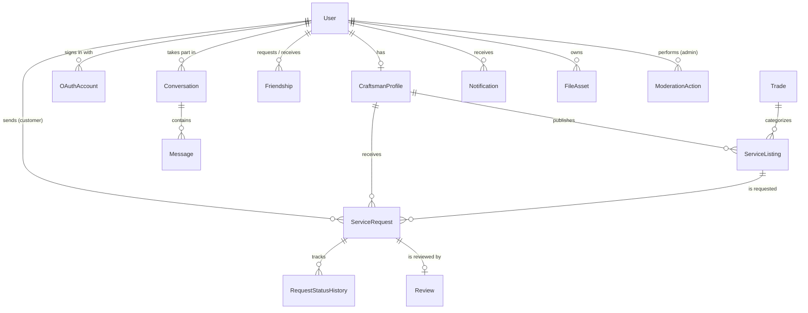

_This project has been created as part of the 42 curriculum by login1, login2, login3, login4, login5._

<!-- TODO (Tech Lead): replace login1..login5 with the real 42 logins. This first line is required and must stay italic. -->

# CraftLink

[](https://github.com/younes-elmakoudi/craftlink/actions/workflows/ci.yml)

> A marketplace that connects customers with local craftsmen (plumbers, electricians, painters, carpenters...).

## Table of contents

1. [Description](#description)
2. [Instructions](#instructions)
3. [Project structure](#project-structure)
4. [Technical stack and architecture](#technical-stack-and-architecture)
5. [Database schema](#database-schema)
6. [API](#api)
7. [Team information](#team-information)
8. [Project management](#project-management)
9. [How we work](#how-we-work)
10. [Features list](#features-list)
11. [Modules](#modules)
12. [Individual contributions](#individual-contributions)
13. [Resources](#resources)
14. [Known limitations](#known-limitations)

---

## Description

**CraftLink** is a web platform where customers find a craftsman, send a service request, follow the job until it is
completed, and leave a review. Craftsmen publish their services, manage their availability and answer requests.
Administrators manage users and moderate content.

**Goal.** Make it simple and trustworthy to hire a craftsman, and give craftsmen a tool to receive and manage jobs.

**Key features**

- Accounts for three roles: customer, craftsman, administrator
- Search craftsmen by trade, city, rating, availability and price
- Service request lifecycle: pending, accepted, in progress, completed (or declined / cancelled)
- Live updates, notifications, friends with online status and one-to-one chat
- Ratings and reviews, photo uploads, administration and moderation tools

## Instructions

### Prerequisites

| Tool | Version | Needed for |
|---|---|---|
| Git | 2.30+ | everything |
| Docker + Docker Compose v2 | Docker 24+ | running the full stack (**the only requirement to just run the project**) |
| Node.js + npm | Node 22 (see `.nvmrc`), npm 10 | local development with hot reload |
| GNU Make | any | optional shortcuts (`make help`) |

### Run the whole project (one command)

```bash
git clone https://github.com/younes-elmakoudi/craftlink.git
cd craftlink
cp .env.example .env          # then edit the values marked CHANGE (passwords, JWT secret)
docker compose up --build     # or: make up
```

| What | URL |
|---|---|
| Application | https://localhost:8443 |
| API documentation (Swagger) | https://localhost:8443/api/docs |
| Health check | https://localhost:8443/api/health |

The first start builds the images, applies the database migrations and inserts demo data.

> **HTTPS certificate.** The certificate is generated automatically and is self-signed, so the browser shows a warning:
> choose "Advanced > Continue to localhost". For a trusted certificate (no warning, required by some browser features),
> install [mkcert](https://github.com/FiloSottile/mkcert), then run
> `mkcert -install && mkcert -cert-file infra/certs/server.crt -key-file infra/certs/server.key localhost 127.0.0.1`
> and restart the stack.

### Demo accounts

All demo accounts use the password `Password123!` (demo data only).

| Role | Email |
|---|---|
| Admin | `admin@craftlink.test` |
| Customer | `customer1@craftlink.test`, `customer2@craftlink.test` |
| Craftsman | `youssef.plumber@craftlink.test`, `sara.electrician@craftlink.test`, `karim.painter@craftlink.test` |

### Local development (hot reload)

Use this while coding: only PostgreSQL runs in Docker, the apps run on your machine.

```bash
make setup        # creates .env, installs dependencies in backend/ and frontend/, generates the Prisma client
make dev-db       # starts PostgreSQL only

# terminal 1: backend  -> http://localhost:3000/api/docs
cd backend
npm run db:migrate         # applies the migrations to your local database
npm run db:seed            # optional: demo data
npm run start:dev

# terminal 2: frontend -> http://localhost:5173
cd frontend
npm run dev
```

The Vite dev server forwards `/api` and `/socket.io` to the backend, so there is no CORS to configure.

### Useful commands

| Command | What it does |
|---|---|
| `make help` | List all shortcuts |
| `make up` / `make down` | Start / stop the full stack |
| `make logs` | Follow the logs |
| `make clean` | Stop and **delete** the database and uploads |
| `make check` | Lint + tests + build of both apps (**run it before every pull request**) |
| `make db-studio` | Browse the database in your browser |

### Environment variables

Copy `.env.example` to `.env` (never commit `.env`). The backend validates them at start-up and tells you what is missing.

| Variable | Purpose |
|---|---|
| `POSTGRES_USER`, `POSTGRES_PASSWORD`, `POSTGRES_DB`, `DB_PORT` | PostgreSQL container |
| `DATABASE_URL` | Connection string used when the backend runs on your machine |
| `JWT_SECRET`, `JWT_EXPIRES_IN`, `COOKIE_NAME`, `COOKIE_SECURE` | Authentication cookie |
| `APP_URL` | Public URL (OAuth callbacks) |
| `UPLOAD_DIR`, `MAX_UPLOAD_MB` | File uploads |
| `SEED_ON_START` | Insert demo data at start-up |
| `OAUTH_GITHUB_CLIENT_ID`, `OAUTH_GITHUB_CLIENT_SECRET` | GitHub sign-in |
| `HTTPS_PORT` | Public HTTPS port of the Docker stack (default 8443) |

### Troubleshooting

| Symptom | Fix |
|---|---|
| `Invalid environment configuration` at backend start | A variable is missing in `.env`; compare with `.env.example` |
| Port already in use | Change `HTTPS_PORT` or `DB_PORT` in `.env` |
| Backend cannot reach the database in local dev | Run `make dev-db` and check that `DATABASE_URL` uses `localhost` |
| Prisma errors about a missing client | Run `cd backend && npx prisma generate` |
| You changed `schema.prisma` and the app fails | Run `npm run db:migrate` in `backend/`, commit the new migration folder |
| Want a fresh database | `make clean`, then `make up` |
| Docker build fails after dependency changes | `docker compose build --no-cache` |

## Project structure

```
craftlink/
├── backend/                  NestJS API + WebSocket gateway (TypeScript)
│   ├── prisma/
│   │   ├── schema.prisma     database schema, the single source of truth
│   │   └── migrations/       SQL history generated by Prisma (committed, never edited)
│   ├── src/
│   │   ├── main.ts           bootstrap: prefix /api, cookies, validation, Swagger
│   │   ├── app.module.ts     registers every module once (do not edit in feature PRs)
│   │   ├── config/           environment validation (fails fast on bad config)
│   │   ├── common/           shared building blocks: AppError, error codes, exception filter, validation
│   │   ├── prisma/           PrismaService (global)
│   │   ├── health/           GET /api/health
│   │   ├── database/         demo data seed
│   │   └── modules/          one folder per business area (auth, users, craftsmen, requests...)
│   ├── Dockerfile            multi-stage image, non-root user
│   └── docker-entrypoint.sh  migrate, optional seed, start
├── frontend/                 React single-page app (TypeScript, Vite, Tailwind)
│   ├── src/
│   │   ├── app/              providers, router, global layout
│   │   ├── components/ui/    design system: reusable, business-free components
│   │   ├── features/         one folder per business area (pages, components, api hooks, locales)
│   │   ├── lib/              API client, socket client, query client, helpers
│   │   ├── i18n/             translation setup + common translations
│   │   ├── styles/           design tokens
│   │   └── types/            types shared by several features
│   └── Dockerfile            builds the site and serves it with nginx
├── infra/
│   ├── nginx/                HTTPS reverse proxy configuration
│   └── certs/                local certificates (git-ignored)
├── docs/
│   ├── architecture.md       how the pieces fit together
│   ├── api-contract.md       endpoints, errors, realtime events: agreed before coding
│   └── adr/                  short records of architecture decisions
├── .github/                  CI workflow, pull request and issue templates, code owners
├── docker-compose.yml        db + backend + web (nginx)
├── Makefile                  shortcuts
├── CONTRIBUTING.md           how we work: branches, commits, pull requests, reviews
└── .env.example              documented environment variables
```

**Where does my code go?**

| I am working on... | I put it in... |
|---|---|
| An API endpoint of a feature | `backend/src/modules/<feature>/` (controller, service, `dto/`) |
| A database table or column | `backend/prisma/schema.prisma` + migration (ask the Tech Lead) |
| A page of a feature | `frontend/src/features/<feature>/pages/`, registered in that feature's `routes.tsx` |
| A reusable button, input, modal... | `frontend/src/components/ui/` and show it on `/design-system` |
| A text visible to users | `frontend/src/features/<feature>/locales/{en,fr,es}.json` |
| A new error returned by the API | `backend/src/common/error-codes.ts` + `frontend/src/i18n/locales/*.json` |
| Docker, nginx, CI | `infra/`, `docker-compose.yml`, `.github/` (small PR, Tech Lead reviews) |

Each module / feature folder has its own `README.md` with its responsibilities and rules.

## Technical stack and architecture

| Layer | Technology | Why |
|---|---|---|
| Frontend | React 19, TypeScript, Vite, Tailwind CSS 4 | Component model, fast feedback, utility-first styling with design tokens |
| Server state | TanStack Query | Caching, loading and error states without a global store |
| Forms | react-hook-form + Zod | Typed validation shared by all forms |
| Internationalization | i18next / react-i18next | English, French, Spanish |
| Real time (client) | socket.io-client | Live updates, chat, presence |
| Backend | NestJS 11 (TypeScript) | Structured architecture (modules, DI, guards) suited to a team |
| Real time (server) | Socket.IO through `@nestjs/websockets` | One authenticated gateway for all live features |
| Database | PostgreSQL 16 | Relational data with strong integrity (requests, reviews, friendships) |
| ORM | Prisma 6 | Typed queries, readable schema, migrations |
| Authentication | JWT in an httpOnly cookie, argon2 password hashing | Tokens unreadable by JavaScript, modern password hashing |
| API docs | `@nestjs/swagger` | Always up-to-date contract for the frontend |
| Reverse proxy | nginx | HTTPS, static files, `/api` and WebSocket proxy |
| Containers | Docker, Docker Compose | One command to run everything |
| CI | GitHub Actions | Lint, tests, build on every pull request |

Architecture overview and the reasoning behind each choice: [`docs/architecture.md`](docs/architecture.md) and
[`docs/adr/`](docs/adr).

```
Browser ──HTTPS──> nginx ──/──────────> static React build
                     ├────/api────────> NestJS ──> PostgreSQL
                     └────/socket.io──> NestJS (WebSocket gateway)
```

## Database schema

Full definition: [`backend/prisma/schema.prisma`](backend/prisma/schema.prisma). Main entities and relations:



| Table | Purpose | Key fields |
|---|---|---|
| `users` | Every account | `email` (unique), `passwordHash` (argon2, null for OAuth-only), `role`, `preferredLanguage`, `status`, `lastSeenAt` |
| `craftsman_profiles` | Extra data of craftsmen | `city`, `bio`, `isAvailable`, `averageRating`, `reviewCount` |
| `trades` | Categories (plumbing, electricity...) | `slug` (unique, also the translation key) |
| `service_listings` | Services offered | `priceType`, `basePrice` (MAD), `isActive`, `moderationStatus` |
| `service_requests` | A customer's request to a craftsman | `status`, `address`, `preferredDate`, `agreedPrice`, `completedAt` |
| `request_status_history` | Audit trail of every status change | `fromStatus`, `toStatus`, `changedById`, `changedAt` |
| `reviews` | One review per completed request | `rating` (1-5), `comment`, `moderationStatus` |
| `friendships` | Friend requests and friendships | `requesterId`, `addresseeId`, `status`; unique pair |
| `conversations`, `messages` | One-to-one chat | sorted user pair (unique), `content`, `sentAt`, `readAt` |
| `notifications` | Events for a user | `type`, `params` (JSON, no text), `readAt` |
| `file_assets` | Uploaded files | `kind`, `path`, `mimeType`, `sizeBytes` |
| `oauth_accounts` | External identities | `provider`, `providerUserId` (unique pair) |
| `moderation_actions` | Admin moderation log | `targetType`, `targetId`, `action`, `reason` |

<!-- TODO (before submission): add an exported ERD image or keep the diagram above up to date. -->

## API

- Interactive documentation: `/api/docs` (Swagger)
- Contract, conventions, error format and realtime events: [`docs/api-contract.md`](docs/api-contract.md)

## Team information

<!-- TODO (Project Manager): complete before submission. Roles required by the subject: PO, PM, Tech Lead, Developers. -->

| Member | 42 login | Role(s) | Responsibilities |
|---|---|---|---|
| Younes Elmakoudi (`younes-elmakoudi`) | yel-mako | Tech Lead | Architecture, database schema, code review, infrastructure |
| Yahya Rafik (`mohrafik`) | mohrafik | Product Owner | Product vision, backlog priorities, validates completed work |
| Omar Eljraouy (`oel-jrao`) | oel-jrao | Project Manager | Meetings, progress tracking, blockers |
| Alae Bendris Alami (`aben-dri`) | aben-dri | Developer | Frontend/backend development, testing, implementation |
| Zakria Jabir (`zajabir`) | zajabir | Developer | Frontend/backend development, testing, implementation |

## Project management

- **Task tracking:** GitHub Issues + a GitHub Projects Kanban board (Backlog, Ready, In progress, In review, Done).
  Every task is an issue with acceptance criteria; every pull request closes an issue (`Closes #12`).
- **Work organization:** the project is split into features and modules, each broken into small issues (about one day of work).
  Issues are assigned to one person and labelled by area (frontend / backend), module and priority.
- **Meetings:** TODO (e.g. short daily sync, planning and review at each milestone).
- **Communication:** TODO (e.g. Discord / Slack channel).
- **Quality:** every change goes through a pull request, CI and at least one review. See [`CONTRIBUTING.md`](CONTRIBUTING.md).

## How we work

Short version (details and examples in [`CONTRIBUTING.md`](CONTRIBUTING.md)):

1. Pick an issue from **Ready**, assign yourself, move it to **In progress**.
2. Create a branch from an up-to-date `main`: `feat/chat-send-message`.
3. Commit small and often with Conventional Commits: `feat(chat): save message in database`.
4. Run `make check`, push, open a pull request titled `type(scope): description`, write `Closes #<issue>`.
5. Wait for CI and one approval, resolve all comments, **squash and merge**, the branch is deleted automatically.

`main` is protected: no direct push, no force push, pull request + 1 approval + green CI required.

## Features list

<!-- TODO (everyone, progressively): one line per implemented feature with the people who built it. -->

| Feature | Description | Members |
|---|---|---|
| TODO | TODO | TODO |

## Modules

<!-- TODO (everyone): fill the last three columns for your modules as you finish them. Major = 2 pts, Minor = 1 pt. -->

| Module | Type | Points | Justification | Implementation | Members |
|---|---|---|---|---|---|
| Frameworks: frontend + backend | Major | 2 | TODO | TODO | TODO |
| ORM for the database | Minor | 1 | TODO | TODO | TODO |
| User management and authentication | Major | 2 | TODO | TODO | TODO |
| Advanced permissions system | Major | 2 | TODO | TODO | TODO |
| Real-time features (WebSockets) | Major | 2 | TODO | TODO | TODO |
| User interaction: chat, profile, friends | Major | 2 | TODO | TODO | TODO |
| Advanced search | Minor | 1 | TODO | TODO | TODO |
| File upload and management | Minor | 1 | TODO | TODO | TODO |
| Notification system | Minor | 1 | TODO | TODO | TODO |
| Custom-made design system | Minor | 1 | TODO | TODO | TODO |
| Progressive Web App | Minor | 1 | TODO | TODO | TODO |
| Remote authentication (OAuth 2.0) | Minor | 1 | TODO | TODO | TODO |
| Multiple languages | Minor | 1 | TODO | TODO | TODO |
| Additional browsers | Minor | 1 | TODO | TODO | TODO |

## Individual contributions

<!-- TODO (everyone, at the end): what you built, the challenges you met and how you solved them. -->

| Member | Contributions | Challenges and solutions |
|---|---|---|
| TODO | TODO | TODO |

## Resources

**Documentation**

- [NestJS](https://docs.nestjs.com/) · [Prisma](https://www.prisma.io/docs) · [Socket.IO](https://socket.io/docs/v4/)
- [React](https://react.dev/) · [Vite](https://vite.dev/) · [Tailwind CSS](https://tailwindcss.com/docs) · [TanStack Query](https://tanstack.com/query/latest)
- [react-i18next](https://react.i18next.com/) · [react-hook-form](https://react-hook-form.com/) · [Zod](https://zod.dev/)
- [Conventional Commits](https://www.conventionalcommits.org/) · [GitHub Flow](https://docs.github.com/en/get-started/using-github/github-flow)

**Use of AI**

<!-- TODO (everyone): describe honestly for which tasks and which parts of the project AI tools were used
     (for example: initial project skeleton, documentation drafts, explanations of concepts, debugging help).
     Everything generated was reviewed, and every member can explain the code they present. -->

## Known limitations

<!-- TODO: e.g. single backend instance (presence is in memory), self-signed certificate in local HTTPS, browser-specific notes. -->
